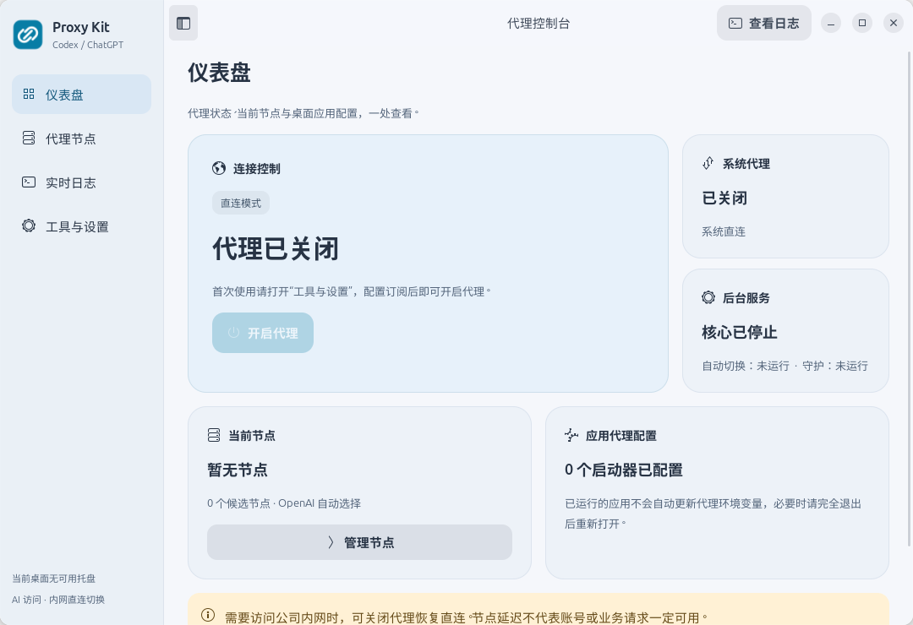

# openai-proxy-kit

面向 Linux 开发者的 **Codex / ChatGPT 代理控制台**：一键启停、原生 GUI、状态托盘与实时日志，方便在 AI 服务访问和公司内网直连之间切换。

控制台、桌面集成和路由引擎由本项目开发，基于 GTK4 / libadwaita 提供原生界面。发行包内置 mihomo 代理核心，路由策略复用系统 Python，**使用者无需安装 Node.js、Git，也无需克隆或保留独立 controller 源码目录**。

当前提供 Ubuntu 24.04 / GNOME 的 amd64 `.deb` 构建。GTK、Python 等系统依赖由包管理器处理；这不是面向所有发行版的单文件静态程序。

## 界面预览



截图来自隔离的离线桌面验证；测试节点与日志示例不表示真实连通性结果。

## 当前功能

- **仪表盘**：浅灰蓝卡片布局，集中展示代理开关、系统代理、后台服务、当前节点与启动器配置；支持浅深色主题。
- **一键启停**：GUI、托盘与 CLI 使用同一套启停逻辑；开启前检查端口归属，关闭时逐协议恢复原设置，保留其他软件后续改动。
- **状态托盘**：专属状态图标，支持打开控制台、启停、查看日志、关闭代理并退出；无托盘支持时提供明确的退出选项。
- **实时日志**：聚合服务日志、守护日志与操作结果，支持来源/级别筛选、搜索、复制、导出和清空视图。离开日志页或隐藏窗口后停止读取。
- **节点管理**：查看当前节点、手动切换和批量延迟测试；轮询更新保留列表行，避免重建造成跳动。
- **内置故障切换**：本项目路由引擎提供候选准入、正式入口复核、失败回滚、节点隔离与新鲜热备证据；支持进程重启后的未完成切换恢复。
- **首次配置与旧部署适配**：GUI 输入订阅进行配置；已有安装可切换到内置控制器，复用原有端口与 unit 名。
- **桌面应用适配**：为选定应用的用户级启动器配置代理环境变量，支持停用和恢复。
- **链路诊断**：检查服务、端口、代理组、连通性、系统代理与指定进程环境变量。
- **代理网站**：按需勾选 GitHub、YouTube，添加自定义域名；设置随用户保存，并可检测各预设的公开端点。

[实时日志预览](docs/images/logs.png) · [深色节点页预览](docs/images/nodes-dark.png)

## 安装与使用

**第一次使用请按[新用户逐步图文教程](docs/team-onboarding.md)操作**：从取得安装包、填写订阅到选择节点、日常启停，以及已有配置时如何更换订阅。

图片显示异常时，可下载[图片内嵌的 HTML 教程](docs/team-onboarding.html)，用浏览器直接打开。

先取得 `.deb` 安装包，并在终端进入它实际保存的目录。`./` 表示终端当前目录，并不表示项目目录；仅克隆源码不会得到安装包。请确认 [Releases](https://github.com/iswangyifan/openai-proxy-kit/releases) 已提供附件，否则使用维护者提供的已验收安装包。

```bash
ls -lh ./openai-proxy-kit_0.4.2_amd64.deb &&
sudo apt install ./openai-proxy-kit_0.4.2_amd64.deb &&
openai-proxy-kit
```

如果安装包由本项目构建生成，请在**项目根目录**执行 `sudo apt install ./dist/openai-proxy-kit_0.4.2_amd64.deb`。也可将命令中的路径替换为安装包的绝对路径。

出现“不支持的文件”时，先检查文件是否存在；安装未成功时不会出现 `openai-proxy-kit` 命令。

从应用菜单打开 **OpenAI Proxy Kit**，在“工具与设置”中输入 Clash YAML 订阅地址，点击“配置并开启代理”。安装软件或只打开窗口不会自动开启代理；首次配置按钮会生成用户服务并开启代理。

```bash
openai-proxy-kit start          # 开启
openai-proxy-kit stop           # 关闭
openai-proxy-kit status         # 查看状态
openai-proxy-kit --logs         # GUI 日志页
openai-proxy-kit logs --follow  # 终端持续输出日志，Ctrl+C 结束
openai-proxy-kit diagnose       # 链路诊断
```

更多说明见[安装与使用](docs/README.md)。

## 使用边界

- 默认 OpenAI 相关域名走代理；可在“代理网站”增加 GitHub、YouTube 或自定义域名，其余直连。不启用 TUN、不修改系统 DNS，也不保证所有企业内网/VPN 环境兼容。
- 启停修改启动器配置，不会更新已经运行的应用进程；VSCode / ChatGPT 可能需要完全退出后重新启动。
- 当前 `start` 同时设置服务自启动，`stop` 同时取消服务自启动；独立自启动设置仍在规划中。
- 节点延迟和路径探测不能保证账号登录或业务请求成功。
- 订阅、节点配置和完整服务日志可能含有敏感信息。控制台会隐藏 URL 与常见凭据字段，分享导出文件前仍应检查。
- GNOME 托盘需要桌面提供 StatusNotifierItem 支持；缺少支持时，控制台不会隐藏成无法找回的状态。
- 本工具不提供订阅、代理节点或账号。

## 从源码构建发行包

开发/构建机器需要 Python 3、curl 和 Debian 打包工具，不需要额外的 JavaScript 运行时。

```bash
bash packaging/fetch-core.sh
bash packaging/build-linux.sh
```

产物位于 `dist/`。路由引擎随软件作为内部模块交付，构建与运行均无需独立控制器工程。构建方法、验证与卸载步骤见[详细文档](docs/README.md)。

## 安全与项目声明

本项目是独立第三方开源工具，与 OpenAI、FlClash 无隶属或背书关系，不提供订阅、节点或账号。请在有权管理的设备和网络中使用，遵守适用法律、组织网络政策及相关服务条款。软件按现状提供，不保证持续可用或特定访问结果；责任与许可边界以各组件许可证为准。

管理 API 使用随机密钥，仅绑定回环地址。订阅与节点配置采用私有权限；日志脱敏不代表可无检查公开。数据流、恢复方法及私密漏洞报告见[安全策略](SECURITY.md)。

## 文档与许可

- [安装与使用](docs/README.md)
- [新用户逐步图文教程](docs/team-onboarding.md)
- [常见问题](docs/troubleshooting.md)
- [后续迭代](docs/roadmap.md)
- [贡献指南](CONTRIBUTING.md)
- [变更记录](CHANGELOG.md)
- [发布与验收流程](docs/releasing.md)
- [0.3.0 实际验收记录](docs/acceptance-2026-11-18.md)
- [第三方组件声明](NOTICE)
- [MIT 许可证](LICENSE)

本项目代码采用 MIT 许可。mihomo、其 Go 依赖以及系统提供的界面库保留各自许可，详见第三方组件声明。
