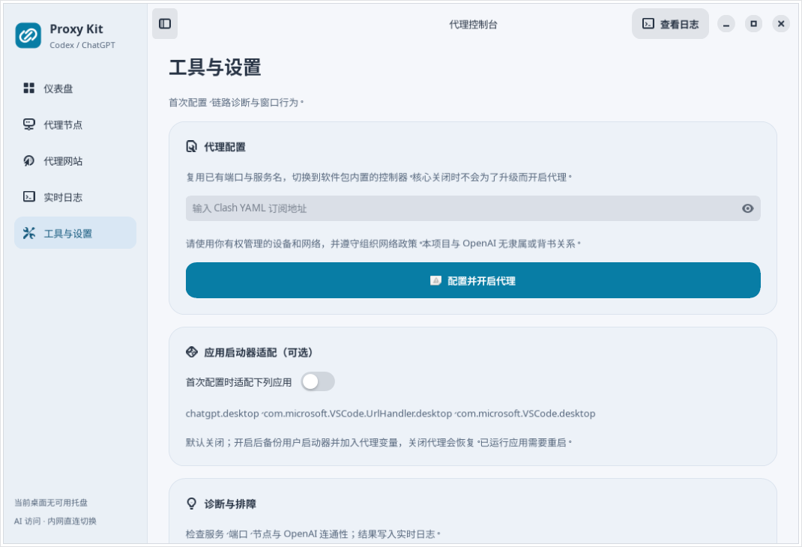
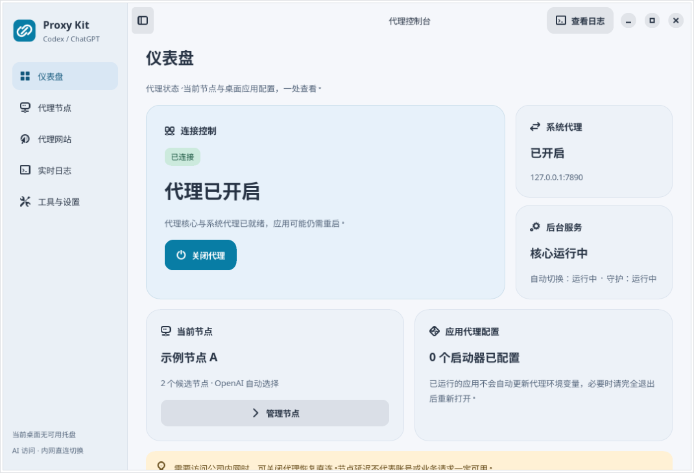
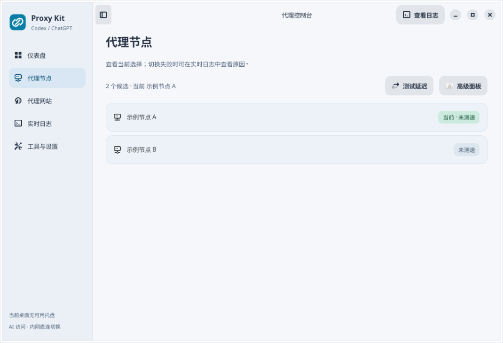
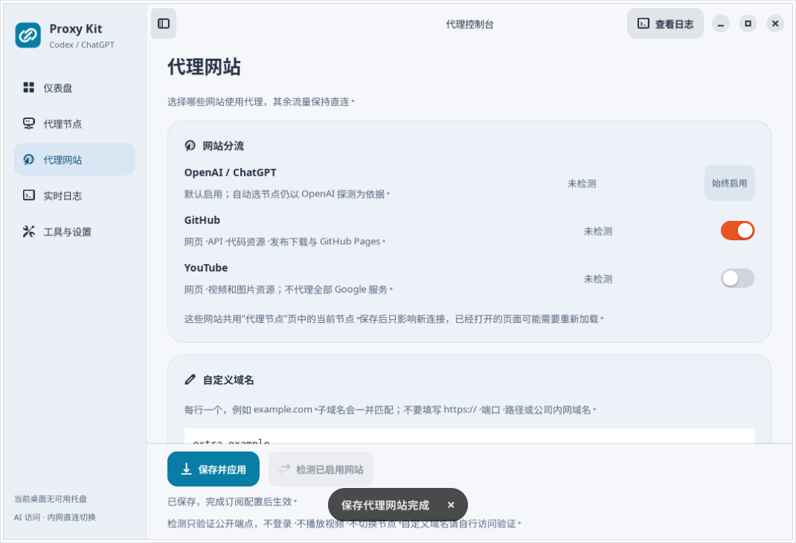
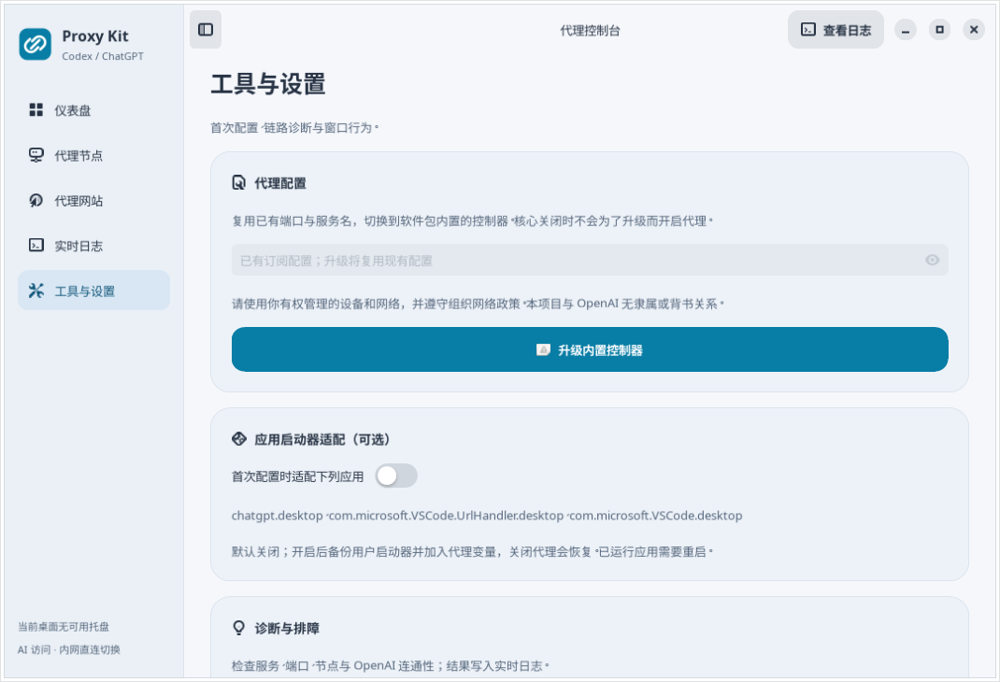
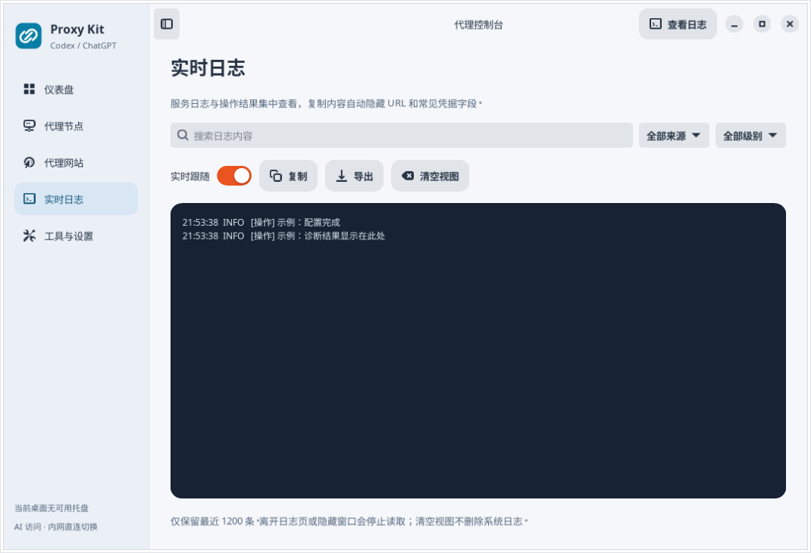

# 新用户上手教程：从下载安装到日常使用

适用于 **openai-proxy-kit 0.4.0、Ubuntu 24.04 / GNOME / amd64**。GNOME 是桌面环境，amd64 对应常见 Intel / AMD 64 位电脑。其他系统与桌面暂未验收。

第一次使用，请按第 1～6 步完成。已经看到灰色订阅框和“升级内置控制器”按钮的用户，先看[第 7 步](#第-7-步已有配置如何更新或更换订阅)。

**看不到图片？** 可下载[图片内嵌的完整 HTML 版](team-onboarding.html)，用浏览器打开；无需另外下载图片文件夹。GitHub 上请阅读文档预览，而不是 `Code` / `Raw` 源码视图。

**图 1：订阅填写入口就在“工具与设置”最上方。** 下图为首次配置界面；本文截图均使用示例状态，节点名和状态用于说明位置，不包含真实订阅。



- [第 1 步：准备安装包和订阅](#第-1-步准备安装包和订阅)
- [第 2 步：安装软件](#第-2-步安装软件)
- [第 3 步：打开控制台，判断当前状态](#第-3-步打开控制台判断当前状态)
- [第 4 步：填写订阅并完成首次配置](#第-4-步填写订阅并完成首次配置)
- [第 5 步：查看和选择节点](#第-5-步查看和选择节点)
- [第 6 步：使用应用、日常启停与退出](#第-6-步使用应用日常启停与退出)
- [第 7 步：已有配置如何更新或更换订阅](#第-7-步已有配置如何更新或更换订阅)
- [第 8 步：出错时按顺序排查](#第-8-步出错时按顺序排查)
- [第 9 步：升级与卸载](#第-9-步升级与卸载)

## 第 1 步：准备安装包和订阅

### 1.1 取得安装包

打开维护者提供的 [GitHub Releases](https://github.com/iswangyifan/openai-proxy-kit/releases) 下载页面，下载以下两个文件到**同一个文件夹**：

- `openai-proxy-kit_0.4.0_amd64.deb`：软件安装包。
- `SHA256SUMS`：与本次安装包配套的校验文件。

如果提供的是更新版本，后续命令中的文件名也要替换成实际版本。

**如果页面没有 `.deb` 附件，请向维护者索取安装包和对应的校验文件。** GitHub 的 `Source code` 压缩包是源码，不是安装程序；仅下载或克隆源码不会得到 `.deb`。

使用者不需要安装 Node、Git，也不需要下载额外控制器源码。系统 Python、GTK 等依赖由 apt 处理。

### 1.2 准备自己的订阅地址

从你有权使用的代理服务提供方取得 **Clash YAML 格式订阅链接**，优先使用 HTTPS。服务方可能把入口叫作“Clash 订阅”“复制订阅地址”或“Clash 配置”。

需要的是订阅配置的下载链接，不是服务方的首页、登录页、支付页、二维码图片或单个节点分享文本。纯 base64 节点列表不能直接使用；请向服务方确认导出格式。

本项目不提供节点、订阅或 OpenAI 账号。订阅链接通常含访问凭据，请保存在自己的安全位置，不要发到聊天群、Issue 或公开仓库。

**本步完成标志：** 已拿到 `.deb`、对应的 `SHA256SUMS`，以及自己的 Clash YAML 订阅链接。

## 第 2 步：安装软件

### 2.1 在安装包所在文件夹打开终端

1. 用“文件”应用找到刚下载的 `.deb`。
2. 在该文件夹的空白处右键，选择“在终端打开”。
3. 在终端执行下面的检查命令：

   ```bash
   ls -lh ./openai-proxy-kit_0.4.0_amd64.deb ./SHA256SUMS
   ```

应该能看到两个文件的文件信息。如果提示“没有那个文件或目录”，先回到文件管理器确认保存位置，不要继续安装。

`./` 表示**终端当前所在目录**。在家目录打开终端，不代表终端已经进入下载目录。

### 2.2 校验安装包

```bash
sha256sum --check --ignore-missing SHA256SUMS
```

应该看到 `.deb` 文件对应的结果为 `OK`。清单也可能包含发布时一起提供的核心源码等附件，`--ignore-missing` 允许不下载这些其他附件。

如果 `.deb` 显示校验失败，重新取得安装包及配套清单后再试。校验和用于确认完整性，目前不是独立数字签名。

### 2.3 执行安装

```bash
sudo apt install ./openai-proxy-kit_0.4.0_amd64.deb
```

1. 输入当前 Ubuntu 用户的 sudo 密码；输入时终端通常不显示字符，输入完按 Enter。
2. 如果询问是否继续，确认安装的软件和依赖后输入 `Y`。
3. 等待安装结束并返回终端提示符，再执行下一步。

如果安装包是维护者在源码目录构建的，应在**项目根目录**使用：

```bash
sudo apt install ./dist/openai-proxy-kit_0.4.0_amd64.deb
```

也可以使用安装包的绝对路径；不要把别人的电脑路径原样复制到自己电脑上。

### 2.4 确认安装成功

```bash
command -v openai-proxy-kit
```

应该输出 `/usr/bin/openai-proxy-kit`。如果没有输出，或运行时提示“未找到命令”，回到安装命令查看错误，先完成安装。

**本步完成标志：** 安装没有报错，终端能找到 `openai-proxy-kit` 命令。

## 第 3 步：打开控制台，判断当前状态

1. 打开 Ubuntu 应用菜单。
2. 搜索 **OpenAI Proxy Kit** 并打开。
3. 也可以在终端执行：

   ```bash
   openai-proxy-kit
   ```

日常运行应用、配置订阅、启停代理都**不要使用 sudo**。sudo 只用于安装、升级安装包和卸载。

打开窗口本身不会主动开启代理。左侧有四个入口：

| 页面 | 用途 |
| --- | --- |
| 仪表盘 | 看代理是否开启、后台服务、当前节点和应用适配状态。 |
| 代理节点 | 查看候选节点、切换当前节点、测试延迟。 |
| 代理网站 | 勾选 GitHub、YouTube，添加自定义域名，保存并检测。 |
| 实时日志 | 查看配置、服务、启停及诊断结果。 |
| 工具与设置 | 首次填写订阅、运行诊断、恢复集成及设置窗口行为。 |

接着点击左侧 **工具与设置**，查看最上方的“代理配置”卡片：

| 看到的界面 | 含义与下一步 |
| --- | --- |
| 可以输入订阅，按钮是“配置并开启代理” | 尚未完成配置，继续第 4 步。 |
| 订阅框灰色，显示“已有订阅配置；升级将复用现有配置”，按钮是“升级内置控制器” | 已检测到旧安装或已有配置。保留原订阅可直接查看节点；更换订阅看第 7 步。 |

对照本文开头的图 1，可以找到首次配置的输入框和按钮。

## 第 4 步：填写订阅并完成首次配置

### 4.1 粘贴订阅地址

1. 保持在 **工具与设置 → 代理配置**。
2. 点击提示“输入 Clash YAML 订阅地址”的输入框。
3. 粘贴第 1 步准备的链接，检查是否多了空格或漏掉一部分。
4. 输入框默认隐藏内容；旁边的眼睛图标可以临时查看，检查后继续隐藏。

界面接收以 `https://` 或 `http://` 开头的订阅地址，不需要手工填写本地端口或 API 密钥。

### 4.2 按需选择应用启动器适配

继续查看下方的 **应用启动器适配（可选）**：

- 只想先验证软件，可以保持默认关闭。
- 准备通过应用菜单启动 VSCode、ChatGPT 桌面版等应用时，可在首次配置前开启此开关。
- 界面会列出发现的候选启动器。适配会备份用户启动器，并加入代理环境变量；关闭代理时恢复。

部分应用不读取 GNOME 系统代理。仅看到系统代理“已开启”，不能证明这些应用已使用代理。已经运行的应用必须完全退出，再从应用菜单打开。

### 4.3 开始配置

1. 点击 **配置并开启代理**。
2. 等待操作完成，不要重复点击。
3. 该操作会读取订阅、生成配置、创建用户服务、开启服务自启动，并设置 GNOME HTTP/HTTPS 代理。
4. 输入框清空是正常的，软件不会在界面持续显示你的订阅链接。
5. 成功后回到左侧 **仪表盘**。

### 4.4 检查配置结果

正常情况下应看到：

- 主状态为 **代理已开启**。
- “系统代理”显示已开启。
- 后台核心处于运行状态。
- “当前节点”显示选中的名称，候选数量大于零。

候选数量取决于你的订阅和当前代理组，不必与他人的截图相同。

**图 2：配置成功后，回到仪表盘核对开启状态和当前节点。** 图中的两个节点为示例。



**本步完成标志：** 仪表盘显示代理已开启，能读到当前节点及候选列表。如果显示“需检查”或节点读取失败，转到第 8 步。

## 第 5 步：查看和选择节点

1. 点击左侧 **代理节点**，也可以从仪表盘点击 **管理节点**。
2. 确认列表中能看到候选节点。
3. 点击希望使用的节点行，等待切换结果。
4. 刷新后，选中的节点会带有 **当前** 标记。
5. 如需比较网络延迟，点击 **测试延迟**，等待结果。

**图 3：点击节点行切换，带“当前”标记的是当前选择；右上方可以测试延迟。**



“未测速”不表示节点一定不可用；延迟较低也不保证账号登录、地区限制或实际业务请求一定成功。软件也可能在检测到当前节点故障后自动选择其他候选。

“高级面板”是可选入口，只有部署已包含网页面板时才可用；灰色不影响本软件的普通使用。

**本步完成标志：** 可以看到当前节点；如手动选择其他节点，能得到切换结果。

### 5.1 增加 GitHub、YouTube 或其他网站

1. 点击左侧 **代理网站**。
2. 打开 GitHub 或 YouTube 旁的开关。OpenAI / ChatGPT 保持默认启用。
3. 如需其他网站，在“自定义域名”中每行填写一个域名，例如 `example.com`。不要填 `https://`、端口、路径、IP 或 `*`，子域名会自动覆盖。
4. 点击 **保存并应用**，等待页面显示保存结果。设置不会因更新订阅或升级软件而丢失。
5. 代理开启时，可点击 **检测已启用网站**，分别查看公开端点结果。尚未配置订阅或代理关闭时，可以先保存，开启后再检测。
6. 回到目标应用验证，已经打开的网页或连接可能需要刷新。



各网站共用当前节点。检测不触发节点切换，也不保证登录或视频播放一定成功；自定义域名需自行访问验证。该规则只作用于进入本工具代理的流量，SSH 或未使用系统代理的终端应用不会被自动接管。详细范围见[代理网站说明](website-routing.md)。

## 第 6 步：使用应用、日常启停与退出

### 6.1 使用 Codex、VSCode 或 ChatGPT

1. 保持软件显示代理已开启。
2. 如果做过启动器适配，完全退出已经运行的目标应用。
3. 从 Ubuntu **应用菜单**重新打开目标应用。
4. 在目标应用中验证自己的正常使用流程。

终端里启动的进程不会继承桌面启动器中的代理变量。如果需要终端方式启动，先按目标应用的方式配置代理；不要假定任意终端命令都会自动使用本工具。

首次配置后仍需添加启动器适配时，在自己的终端执行：

```bash
bash /usr/lib/openai-proxy-kit/install.sh desktop
```

按提示逐个选择应用，不要加 sudo。适配后仍需要重开目标应用。

### 6.2 需要代理时开启

在仪表盘点击 **开启代理**，或从托盘菜单操作。终端方式为：

```bash
openai-proxy-kit start
```

### 6.3 访问内网异常时关闭

在仪表盘点击 **关闭代理**，等状态刷新为已关闭后，再重试内网页面。终端方式为：

```bash
openai-proxy-kit stop
```

默认只有指定的 OpenAI 相关目标走代理；“代理网站”中新增的目标也会走代理，其余直连。企业 DNS、VPN 和内网站点的兼容性仍取决于实际环境，需要时关闭代理。

关闭会恢复接管前的设置。如果原来有其他代理，恢复结果可能仍是原来的代理。已经运行的应用环境变量也需要通过完全退出、重新打开来更新。

### 6.4 区分关闭窗口与关闭代理

- 托盘可用且启用了“关闭窗口时保留托盘”时，点击右上角关闭按钮会隐藏窗口，代理可能继续运行。
- 没有可用托盘时，关闭窗口会询问退出方式；“保留代理并退出”会保留当前代理状态。
- 希望一并关闭代理和界面，请到 **工具与设置 → 窗口行为 → 关闭代理并退出**。

当前“开启”同时启用服务自启动，“关闭”同时取消服务自启动，尚无独立的自启动开关。GNOME 缺少托盘扩展时仍可使用窗口。

## 第 7 步：已有配置如何更新或更换订阅

### 7.1 输入框灰色是什么意思

**图 4：灰色订阅框表示已有配置。** 你看到“升级内置控制器”时，对应下图：



此时：

- 订阅框不会显示已保存的链接，也不能直接输入新的地址。
- **升级内置控制器**会复用已有配置来更新本项目路由服务，不会更换订阅地址。
- 如果想继续使用现有订阅，可以直接开启代理、查看节点，无需重新填写。

### 7.2 更新原订阅中的节点

地址不变，只希望拉取服务方最新节点时，在当前用户终端执行：

```bash
openai-proxy-kit update
```

此命令使用保存的原订阅地址。开启状态下更新可能重启核心并短暂影响连接；关闭状态下不会为更新而主动开启代理。完成后回到节点页查看结果。

### 7.3 更换为另一个订阅地址

当前版本没有独立的“更换订阅”按钮，可以通过以下现有流程完成。**此操作会先关闭代理，恢复用户服务和启动器集成，请先保存工作，并确保手中已有新订阅地址。**

1. 打开 **工具与设置**。
2. 向下滚动到 **诊断与排障**。
3. 点击 **恢复用户集成**。
4. 阅读弹窗，确认后选择 **恢复并保留配置**。
5. 等待恢复完成；程序会保留私有配置和备份，不会删除订阅数据作为清理手段。
6. 回到本页最上方，订阅框应可输入，按钮变为 **配置并开启代理**。
7. 粘贴新订阅，重新选择是否适配应用，按第 4 步完成配置。
8. 重新打开受影响的目标应用，再查看新节点。

不要把“升级内置控制器”当成更换订阅的入口，也不需要手工修改 API 密钥或删除配置目录。

## 第 8 步：出错时按顺序排查

### 8.1 先看仪表盘的具体说明

| 现象 | 含义与处理 |
| --- | --- |
| apt 提示“不支持的文件” | 先用第 2 步的 `ls` 确认文件存在，检查终端目录和文件名，或使用绝对路径。 |
| `openai-proxy-kit：未找到命令` | 安装尚未完成，回到 apt 错误处理；不要通过重复运行应用命令来解决。 |
| 订阅输入框灰色 | 已有配置，按第 7 步操作。 |
| “需检查” | 核心、系统代理或节点读取没有全部就绪；阅读仪表盘下方具体原因。 |
| “节点读取失败” | 管理 API 没有返回节点列表，不等于订阅没有节点。配置从外部更新后会自动刷新；必要时点击“刷新状态”。 |
| 节点列表为空、核心未启动 | 先确认是否已配置订阅并开启代理，再查看日志。 |
| 核心运行但代理组没有候选 | 检查订阅是否为有效 Clash YAML、是否包含所需节点，再更新原订阅或更换订阅。 |
| 其他代理占用端口 | 先确认是否有其他代理软件运行；选择只保留一套代理运行，再尝试开启。 |
| 应用仍无法访问 | 检查启动器是否适配、应用是否彻底退出后从菜单重开；再确认节点及账号服务情况。 |
| 没有托盘图标 | 当前桌面可能缺少或未启用 AppIndicator 扩展，仍可使用窗口操作。 |

### 8.2 运行软件内的诊断

1. 打开 **工具与设置**。
2. 找到 **诊断与排障**。
3. 点击 **运行链路诊断**。
4. 程序会切换到 **实时日志** 页面，等待诊断结束。
5. 从错误附近的日志查看失败环节。

**图 5：诊断结果会出现在实时日志页面，可在上方筛选、复制或导出。** 图中为示例日志。



需要在终端查看时，可执行：

```bash
openai-proxy-kit status
openai-proxy-kit diagnose
```

### 8.3 向维护者反馈

提供软件版本、Ubuntu/桌面版本、操作步骤、错误提示和脱敏日志。软件包版本可通过下面的命令查看：

```bash
dpkg-query -W openai-proxy-kit
```

在“实时日志”中可筛选、复制或导出。日志会做常见凭据脱敏，但发送前仍需自行检查。不要公开订阅 URL、节点密码、Cookie、API 密钥或完整配置；漏洞报告使用[私密安全渠道](../SECURITY.md)。

## 第 9 步：升级与卸载

### 9.1 升级软件版本

1. 从维护者取得新版 `.deb` 及对应校验文件。
2. 按第 2 步核对文件和校验和，安装新版；命令中的版本号改为实际文件名。
3. 如果控制台正在运行，打开 **工具与设置 → 窗口行为 → 关闭代理并退出**，完整退出旧界面。此操作会关闭代理。如果需要保留代理，可先关闭“关闭窗口时保留托盘”开关，再点击窗口关闭，在弹窗中选择“保留代理并退出”。
4. 在当前用户终端执行下列命令，迁移已有配置：

   ```bash
   openai-proxy-kit upgrade
   ```

5. 重新打开控制台，回到仪表盘检查状态和节点，需要使用时再开启代理。迁移命令保留用户配置；核心原本关闭时保持关闭，原本运行时可能重启核心。

`update` 更新订阅节点，`upgrade` 迁移本项目服务和配置；两者不是下载、安装新版 `.deb` 的替代操作。

### 9.2 卸载

在终端执行：

```bash
sudo apt remove openai-proxy-kit
```

正常卸载会按已登记用户清理服务、恢复代理和启动器，并保留私有配置与备份。清理失败时先查看提示并重试，不要强制跳过维护脚本。

如果还需要移除保留的敏感数据，先核对实际目录及其他部署是否共用，再按照[安装与恢复文档](README.md)处理；不要随意递归删除共享配置目录。

## 最后检查一次

完成上手后，应能够独立完成以下操作：

- 找到“工具与设置”并确认订阅配置状态。
- 开启代理后，在“代理节点”看到候选列表。
- 在需要时关闭代理，并知道关闭窗口不一定会关闭代理。
- 知道更新原订阅、更换订阅和升级软件的区别。
- 出错时找到具体提示、运行诊断并提供脱敏反馈。

验证范围和限制见[发行验收记录](acceptance-2026-11-18.md)，开发者发布流程见[发布流程](releasing.md)。
